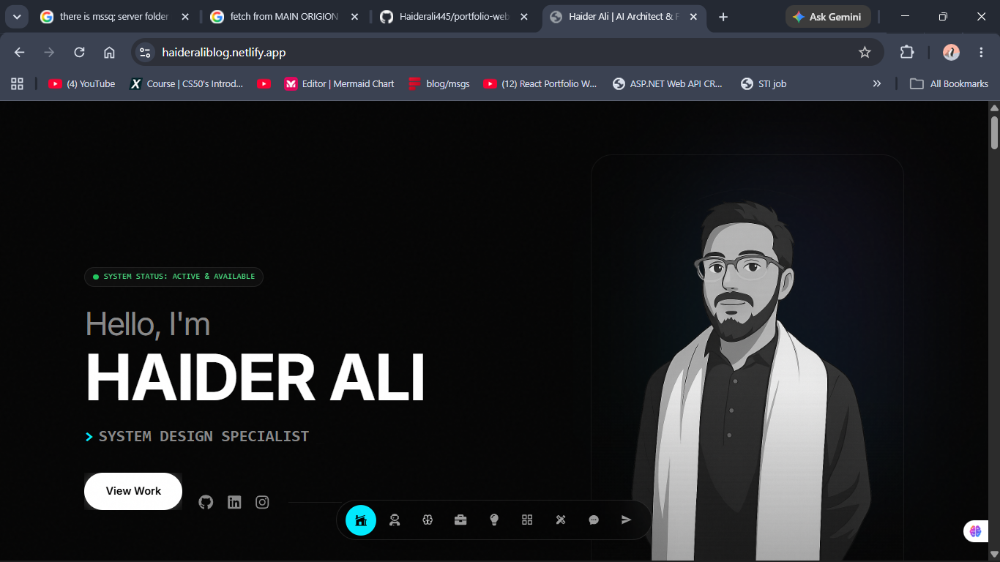
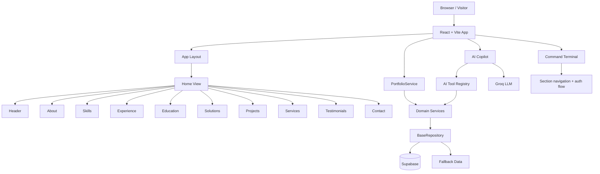
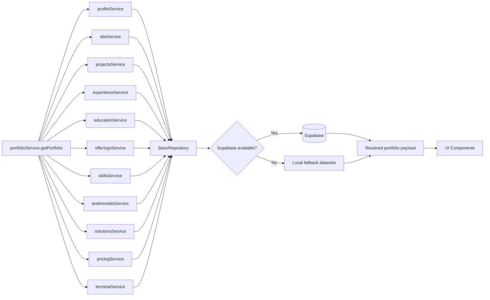
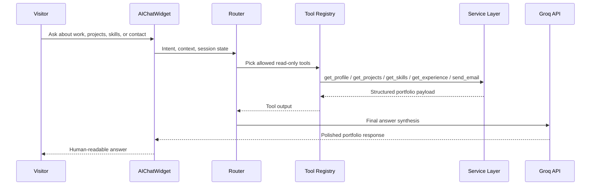

# ⚡ Ego Web

> Production-grade cinematic portfolio engineered as a product system, not a template.

<div align="center">


</div>

<p align="center">
  
</p>

> [!IMPORTANT]
> This repository is closed for public contributions. Please review the contribution policy and licensing terms before proposing changes.

## 🧭 Overview

Ego Web is a personal portfolio and engineering showcase for Haider Ali. It combines cinematic visual design, interactive product-like UI, and a strong system architecture that separates presentation, service logic, and data access.

This project is built to demonstrate:

- a polished portfolio experience rather than a static landing page
- layered architecture with service-first data handling
- resilient fallback patterns for live data and external APIs
- interactive developer features like the command terminal and code playground
- AI assistant tooling that works from the portfolio domain model

## 🗺️ One-to-one product map

| Experience | Implementation | Notes |
|---|---|---|
| Hero | `src/components/header/Header.jsx` | Intro, CTA, typewriter titles, profile badge |
| About | `src/components/about/About.jsx` | Bio, focus areas, JSON profile inspector, JS playground |
| Skills | `src/components/skills/Skills.jsx` | Technical stack and categorized skill groups |
| Experience timeline | `src/components/experience/Experience.jsx` | Career history and company links |
| Education | `src/components/education/Education.jsx` | Academic and certification record |
| Solutions | `src/components/solutions/Solutions.jsx` | Technical challenge stories |
| Projects | `src/components/projects/Projects.jsx` | Portfolio project gallery and highlights |
| Services | `src/components/services/Services.jsx` | Offerings, detail pages, and productized offerings |
| Testimonials | `src/components/testimonials/Testimonials.jsx` | Proof points and client sentiment |
| Contact | `src/components/contact/Contact.jsx` | EmailJS-powered contact workflow |
| Terminal | `src/components/helper/CommandTerminal.jsx` | Developer-style terminal with protected commands |
| AI assistant | `src/components/helper/AIChatWidget.jsx` | Groq-backed portfolio copilot |
| App shell | `src/layout/AppLayout.jsx` | Navigation, routes, overlays, global layout |
| Data layer | `src/api/portfolio.service.js` | Aggregates domain services and fallback data |
| Repository layer | `src/api/core/base.repository.js` | Shared repository abstraction |

## 🏗️ Architecture

### High-level system flow



### Data resilience model



### AI assistant flow



## ✨ Core features

- ⚛️ Cinematic hero section with animated typewriter titles, subtle parallax motion, and `rgba(255,255,255,0.05)` architectural grid
- 🧠 About area with bio, interests, JSON profile inspector, and sandboxed JavaScript playground
- 🛠️ Skills taxonomy grouped by technology domain with per-category glow accents
- 💼 Experience timeline with company metadata and external links
- 🎓 Education and milestone records
- 📦 Project gallery with tech tags, links, and contributor details
- 🧩 Service detail pages with offerings and solution storytelling
- 🧪 Testimonials and social proof
- 📬 Contact form powered by EmailJS with toast feedback
- 📊 GitHub activity and language metrics banner
- 🖥️ Command terminal with protected commands and root-like auth flow
- 🤖 AI copilot with portfolio-aware tools and Groq fallback models
- 🌐 Smooth scrolling experience via Lenis and responsive page behavior
- 🧱 Loading states, error handling, and graceful fallbacks

### Design System v2 — Active Standards
- **Canvas**: Pure black `#000000`. Surface elevations: `#121212` / `#181818` / `#222222`
- **Cards**: `bg-[#141414]/85 backdrop-blur-xl border border-white/[0.08]` + top specular edge `via-white/10`
- **2-Scale Headings**: `White Primary <span class="text-white/40">Muted Secondary</span>` — uniform across all sections
- **Grid**: `rgba(255,255,255,0.05)` 32px architectural grid scoped to Hero only. Per-section grids removed.
- **Noise**: `body::after` SVG fractal noise overlay at `z-index: 50`, `opacity: 0.4`
- **Motion**: `cubic-bezier(0.16, 1, 0.3, 1)` deceleration on all interactive elements


## 🧰 Tech stack

### Frontend
- React 18
- Vite 4
- Tailwind CSS 3
- Framer Motion
- Lenis smooth scrolling
- React Router DOM
- Recharts and visual widgets
- Swiper, GitHub calendar, typewriter UI helpers

### Data and API layer
- Supabase JS client
- Base repository abstraction
- Domain-specific service modules
- Structured fallback content
- Promise-based portfolio aggregation with resilience checks

### AI and communication
- Groq API + model fallback chain
- Read-only tool registry for portfolio queries
- EmailJS for contact delivery
- Session-aware and intent-aware chat flow

### Developer experience
- architecture-first frontend organization
- service-first data access patterns
- centralized logging utilities
- responsive layouts with reduced-motion support
- accessible interactive controls

## 📁 Project structure

```text
.
├── 📄 .env
├── 📄 .gitignore
├── 📄 .nvmrc
├── 📄 CONTRIBUTING.md
├── 📄 LICENSE
├── 📄 README.md
├── 📁 docs/
│   └── 🖼️ web.png
├── 📄 index.html
├── 📄 netlify.toml
├── 📄 package.json
├── 📄 postcss.config.js
├── 📄 tailwind.config.js
├── 📄 vite.config.js
├── 📁 src/
│   ├── 📄 App.jsx
│   ├── 📄 main.jsx
│   ├── 📁 api/
│   │   ├── 📁 ai/
│   │   │   ├── 📄 ai.config.js
│   │   │   ├── 📄 ai.router.js
│   │   │   ├── 📄 ai.service.js
│   │   │   ├── 📄 ai.tools.js
│   │   │   ├── 📄 intentNormalizer.js
│   │   │   └── 📄 tokenUsageGuard.js
│   │   ├── 📁 core/
│   │   │   ├── 📄 apiClient.js
│   │   │   ├── 📄 base.repository.js
│   │   │   ├── 📄 logger.js
│   │   │   └── 📄 supabase.client.js
│   │   ├── 📄 portfolio.service.js
│   │   └── 📁 services/
│   │       ├── 📄 contact.service.js
│   │       ├── 📄 education.service.js
│   │       ├── 📄 experience.service.js
│   │       ├── 📄 github.service.js
│   │       ├── 📄 gmail.service.js
│   │       ├── 📄 offerings.service.js
│   │       ├── 📄 pricing.service.js
│   │       ├── 📄 profile.service.js
│   │       ├── 📄 projects.service.js
│   │       ├── 📄 site.service.js
│   │       ├── 📄 skills.service.js
│   │       ├── 📄 solutions.service.js
│   │       ├── 📄 terminal.service.js
│   │       └── 📄 testimonials.service.js
│   ├── 📁 components/
│   │   ├── 📁 about/
│   │   ├── 📁 common/
│   │   ├── 📁 contact/
│   │   ├── 📁 education/
│   │   ├── 📁 experience/
│   │   ├── 📁 footer/
│   │   ├── 📁 header/
│   │   ├── 📁 helper/
│   │   ├── 📁 nav/
│   │   ├── 📁 projects/
│   │   ├── 📁 services/
│   │   ├── 📁 sidebar/
│   │   ├── 📁 skills/
│   │   ├── 📁 solutions/
│   │   └── 📁 testimonials/
│   ├── 📁 hooks/
│   │   ├── 📄 useAIChat.js
│   │   ├── 📄 useExperience.js
│   │   ├── 📄 useGitHubStats.js
│   │   ├── 📄 useLenis.js
│   │   └── 📄 usePortfolioData.js
│   ├── 📁 layout/
│   │   └── 📄 AppLayout.jsx
│   ├── 📁 utils/
│   │   ├── 📁 data/
│   │   ├── 📁 functions/
│   │   └── 📁 images/
│   ├── 📁 views/
│   │   ├── 📄 Home.jsx
│   │   └── 📄 ServiceDetail.jsx
│   └── 📁 styles/
│       └── 📄 prism-vsc-dark-plus.css
└──
```

## 🚀 Local development

### Prerequisites
- Node.js 18+
- npm
- optional: Supabase access and Groq API keys for live integrations

### Install

```bash
npm install
```

### Run locally

```bash
npm run dev
```

### Production build

```bash
npm run build
npm run serve
```

## 🔐 Environment variables

The app expects these environment variables for live integrations:

```bash
VITE_SUPABASE_URL=
VITE_SUPABASE_PUBLISHABLE_KEY=
VITE_USE_BACKEND=true
VITE_EMAILJS_SERVICE_ID=
VITE_EMAILJS_TEMPLATE_ID=
VITE_EMAILJS_PUBLIC_KEY=
VITE_PORTFOLIO_OWNER_EMAIL=
VITE_GROQ_API_KEY=
VITE_GITHUB_TOKEN=
```

When live services are unavailable, the app uses structured fallback data to keep the portfolio experience working.

## 🧩 Deployment notes

This project is optimized for static shipping and is configured for Netlify via `netlify.toml`.

It is designed to:

- render as a client-side portfolio application
- fetch live data from Supabase and GitHub when available
- gracefully degrade to local structured content if services fail
- support AI and contact workflows without breaking the site experience

## 📌 Repository intent

Ego Web is best understood as a portfolio system instead of a plain static landing page. It aims to:

1. showcase technical depth and product polish
2. demonstrate service-oriented architecture and maintainable data flow
3. integrate AI and terminal interactions without losing portfolio focus
4. keep content maintainable and data-driven
5. provide a professional, living engineering brand presence

## 📝 Contribution policy

This project is intentionally not open for general public pull requests. Please review the repository contribution policy and licensing details before attempting changes or outreach.

## 📄 License

See `LICENSE` for project licensing information.
